# 实验四 实验报告：用 Vue 3 重写博客站

- 班级：24 软件工程 1 班
- 姓名：陈宥佳
- 学号：2024034743028
- 完成范围：任务一至任务六（必做基础分），含六个任务的页面截图、技术点对照表、AI 使用声明与代码自查；部署（"尤佳"项）未做，仅完成本地生产预览验证

---

## 一、实验目的

1. 掌握 Vue 3 的组合式 API：`ref` / `reactive`、`computed`、`watch`、生命周期；
2. 掌握单文件组件与组件通信：`props` / `emits`、`provide` / `inject`、插槽；
3. 掌握 Vue Router 的动态路由、参数约束与守卫，能用 `beforeEach` 承担跨页面逻辑；
4. 掌握 Pinia 状态管理与持久化，理解「数据放 store、组件只读」的边界；
5. 掌握 Axios 请求封装与「加载中 / 成功 / 失败」三态的完整闭环；
6. 把实验三的 Next.js 博客用 Vue 3 重写一遍，完成两套框架的四维对照，形成可迁移的框架观。

## 二、实验环境与工具

| 项目 | 版本/说明 |
|---|---|
| 操作系统 | Windows 11 |
| Node.js | v24.16.0（满足 20 以上要求） |
| pnpm | 12.4.2 |
| Vue | 3.5.45 |
| Vue Router | 5.4.0 |
| Pinia | 4.1.0 |
| pinia-plugin-persistedstate | 4.7.1 |
| Axios | 1.21.1 |
| Vite | 8.3.7 |
| TypeScript | 6.0.3（`vue-tsc` 做类型检查） |
| 编辑器 | VS Code（Volar 插件） |
| 浏览器 | Microsoft Edge（全部页面截图在本机 Edge 中全屏截取） |

项目建在纯英文路径 `C:\Users\cyj\Desktop\se3306-exp4\lab4-blog`，开发端口 5173，预览端口 4173。

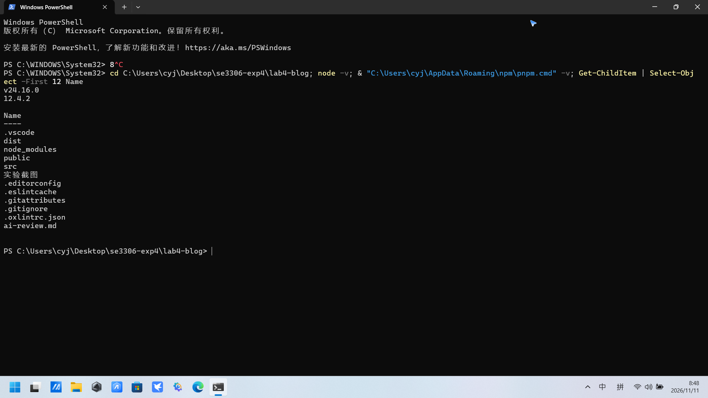

## 三、实验原理

- **组合式 API**：`ref` 把值包装成响应式对象，通过 `.value` 读写；`reactive` 让对象变成响应式代理；`computed` 是带缓存的派生值，依赖变化才重算；`watch` 在值变化时执行副作用。模板读取响应式数据时会自动追踪依赖，数据变了视图自动更新。
- **单文件组件**：`.vue` 把模板、逻辑、样式放在一个文件；`<script setup>` 的顶层绑定自动暴露给模板；`scoped` 让样式只作用于当前组件。
- **组件通信**：父传子用 `props`（`defineProps`），子传父用事件（`defineEmits` + `emit`），跨层级用 `provide` / `inject`，内容分发用插槽。
- **状态管理**：Pinia 的 setup store 用 `ref` 声明 state、`computed` 声明 getter、函数声明 action；`pinia-plugin-persistedstate` 的 `persist` 配置决定存哪些字段、存到哪个 key。
- **路由**：Vue Router 用显式路由表映射路径与组件；`:id(\\d+)` 是参数正则约束；`/:pathMatch(.*)*` 是兜底；`beforeEach` 在每次导航前执行，适合放跨页面的统计、鉴权。
- **请求与三态**：Axios 封装成 api 层，页面用 `status` 标记 `loading / ready / error`，配合骨架屏、错误提示与重试按钮形成闭环。

## 四、实验内容与步骤（任务一至六）

### 任务一 跑起来与组件化

- **小步 1.1** 用 `pnpm dlx create-vue@latest lab4-blog --typescript --router --pinia --eslint` 生成脚手架，`pnpm install` 296 个依赖安装成功；
- **小步 1.2** 删除脚手架自带的 `HelloWorld`、`TheWelcome`、`WelcomeItem` 示例组件，把 `index.html` 的 `lang` 改为 `zh-CN`、标题改为"我的博客"，`vite.config.ts` 移除 `vite-plugin-vue-devtools`（避免开发浮层影响截图）；
- **小步 1.3** 拆分组件：`AppHeader`（导航）、`AppFooter`（页脚）、`PostItem`（文章卡片），首页用 `v-for` 渲染 6 张卡片，同一份模板复用；
- **小步 1.4** `PostItem` 用 `defineProps` 接收 `post / likes / views / liked` 四个 props，用 `defineEmits` 声明 `like` 事件把点赞上抛，组件自身不直接改数据。

```vue
const props = defineProps<{ post: Post; likes: number; views: number; liked: boolean }>()
const emit = defineEmits<{ like: [id: number] }>()
```

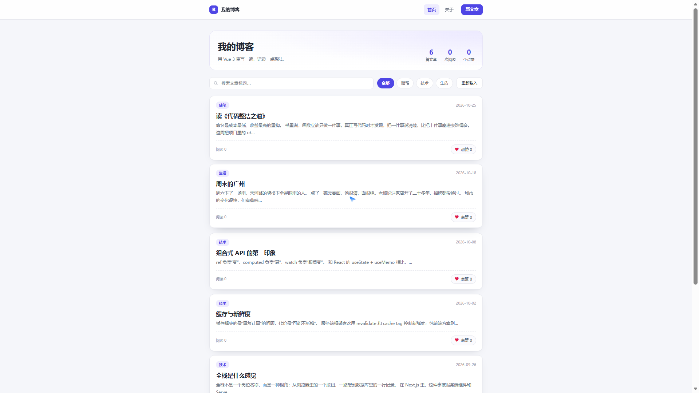
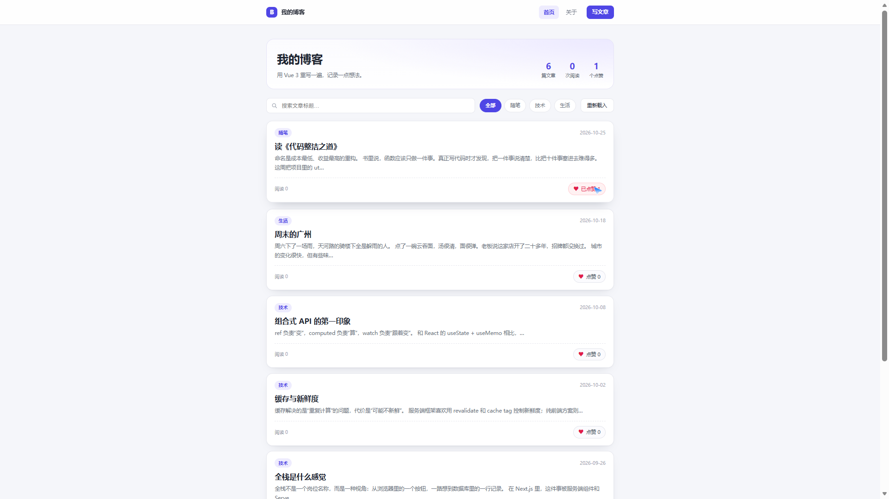

自检结果：`pnpm dev` 启动后 5173 端口正常；6 篇文章的卡片样式一致，说明 `PostItem` 被复用；点赞按钮可点击，数字随之变化。

### 任务二 列表与搜索

- **小步 2.1** 搜索框用 `v-model` 双向绑定 `keyword`，输入即生效，不需要监听 `input` 事件；
- **小步 2.2** 过滤逻辑写成 `computed`，同时承担分类筛选与标题匹配，模板只读 `filtered`；
- **小步 2.3** 结果为空时用 `v-if` 切换到 `EmptyState` 组件，提示文案通过插槽传入，组件本身不写死文案。

```ts
const filtered = computed(() => {
  const kw = keyword.value.trim()
  return blog.sortedPosts.filter((post) => {
    const matchCategory = activeCategory.value === '全部' || post.category === activeCategory.value
    return matchCategory && (!kw || post.title.includes(kw))
  })
})
```

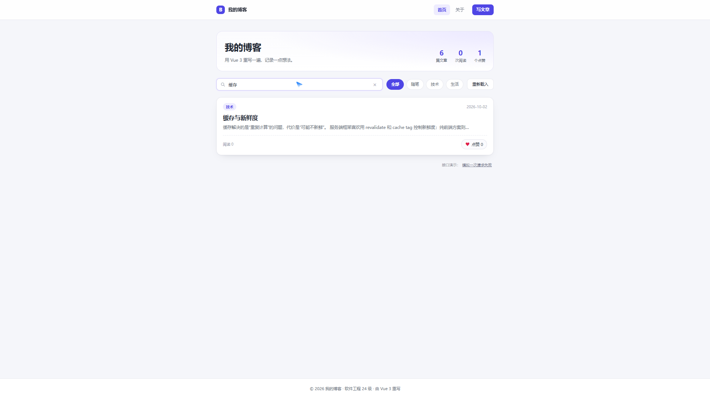
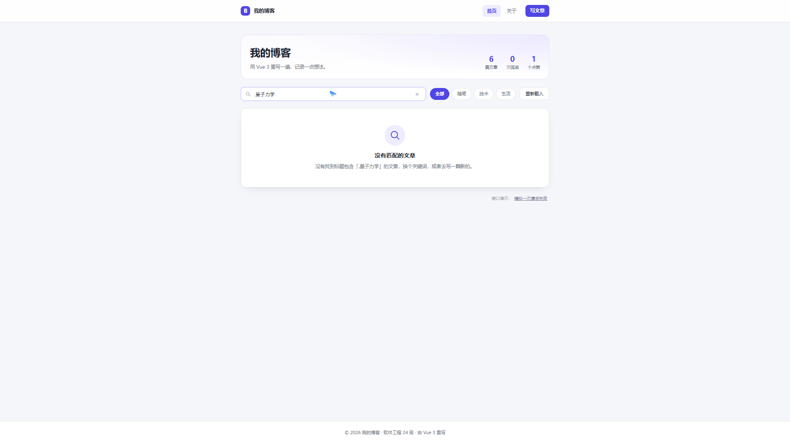

自检结果：输入"缓存"，列表从 6 篇过滤到 1 篇；输入"量子力学"，列表为空并显示空状态卡片；清空关键词后恢复全部。

### 任务三 点赞与浏览量

- **小步 3.1** `PostItem` 触发 `like` 事件，`HomeView` 用 `@like="blog.likePost"` 把事件直接接到 store 的 action；
- **小步 3.2** 计数统一放进 Pinia：`likes`、`views`、`liked` 三个对象以 id 为键，`likePost` 里先判断 `liked` 再自增，避免重复点赞；
- **小步 3.3** 开启 `persist`，只挑业务字段落盘；`status`、`errorText` 这类运行时状态不持久化，防止刷新后卡在 loading；
- **小步 3.4** 浏览量放在路由守卫里累加：`router.beforeEach` 判断目标路由是详情页时调用 `viewPost(id)`，刷新详情页也会执行。

```ts
persist: {
  key: 'lab4-blog',
  pick: ['posts', 'likes', 'views', 'liked', 'comments', 'loaded'],
}
```

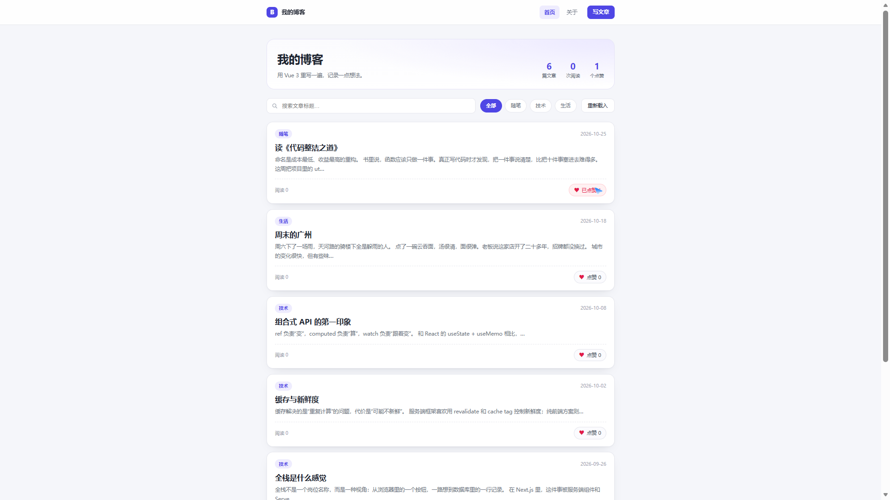

自检结果：点赞后按钮变"已点赞 1"、顶部统计"1 个点赞"；按 F5 刷新，两个数字都还在，说明写进了 `localStorage`（key `lab4-blog`）。

**点赞一次，界面变化的位置**：① 卡片上的数字 0→1；② 按钮文字变"已点赞"并置灰；③ 首页 hero 的"个点赞"总数 +1；④ 若正停在详情页，详情的点赞数与按钮同时变；⑤ 变化同步写入持久化存储，刷新后仍成立。

### 任务四 详情与路由

- **小步 4.1** 建路由表：`/`、`/posts/:id(\\d+)`、`/new`、`/about`、`/:pathMatch(.*)*`，四个页面用 `() => import(...)` 懒加载；
- **小步 4.2** 详情页用 `useRoute` 取参、`computed` 从 store 找文章，所以列表页点过赞再进详情，数字是连贯的；
- **小步 4.3** 参数加正则约束，`/posts/abc` 不匹配动态路由，直接落到 404；404 页给"回到首页"按钮；
- **小步 4.4** `scrollBehavior` 让每次切页回到顶部，详情页刷新后内容、点赞、评论都还在（数据来自持久化 store）。

```ts
{ path: '/posts/:id(\\d+)', name: 'post-detail', component: () => import('@/views/PostDetailView.vue') },
{ path: '/:pathMatch(.*)*', name: 'not-found', component: () => import('@/views/NotFoundView.vue') },
```

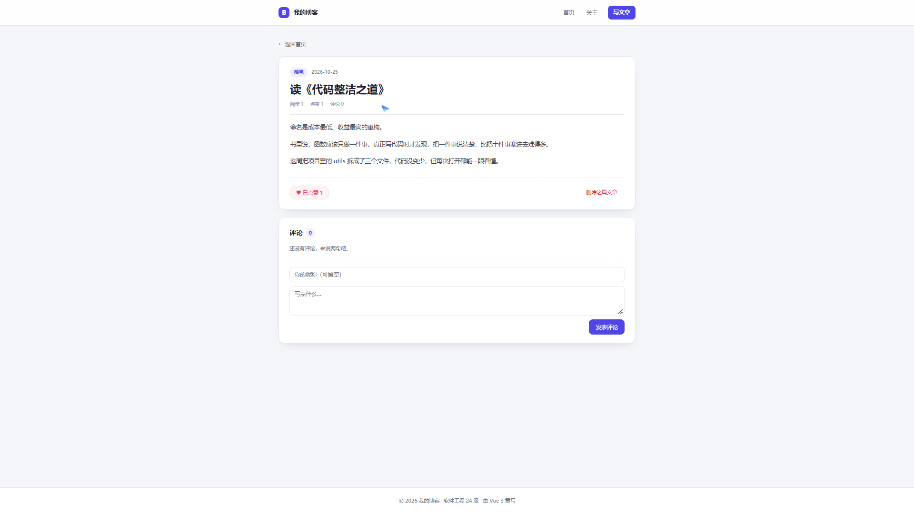
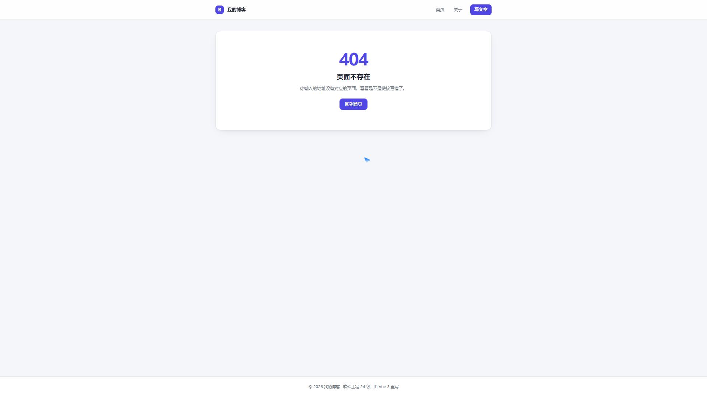

自检结果：列表点标题进入 `/posts/6`，地址栏与页面内容一致；直接刷新详情页，文章与点赞、评论都在；访问 `/posthg` 显示 404。

### 任务五 发布与评论

- **小步 5.1** 发布页用 `v-model` 绑定标题、正文，分类用胶囊按钮切换；提交时先 `trim` 再判空，空标题直接返回错误提示，不跳转；
- **小步 5.2** 校验通过后 `addPost` 写入 store（id 取当前最大值 +1，日期取当天），再 `router.push('/')` 回首页，新文章排在最前；
- **小步 5.3** 评论区用 `comments` 按 `postId` 过滤渲染，昵称留空时存"匿名读者"；提交时校验内容非空，成功后清空表单；
- **小步 5.4** 评论与文章一起持久化，刷新详情页评论仍在；重新拉取接口时用「远端数据 + 本地新增」合并，避免自己发布的文章被远端数据冲掉。

```ts
function submit() {
  if (!title.value.trim()) { error.value = '标题不能为空'; return }
  error.value = ''
  blog.addPost({ title: title.value.trim(), category: category.value, content: content.value.trim() })
  router.push('/')
}
```

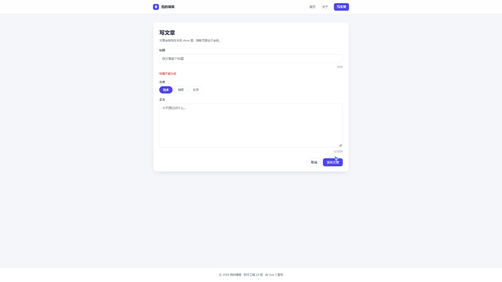
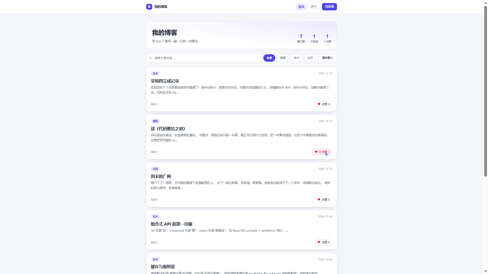
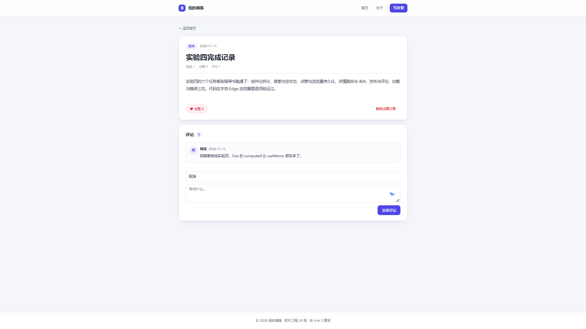


自检结果：空标题点发布出现红色"标题不能为空"，页面不跳转；填好标题正文后发布，回首页看到新文章置顶、总数 7 篇；发表评论后计数 0→1，刷新后仍在。

### 任务六 加载与错误

- **小步 6.1** `api/posts.ts` 用 Axios 请求 `public/posts.json`，请求前 `sleep(500 + Math.random() * 500)` 模拟 0.5~1 秒延迟；
- **小步 6.2** `simulateNextFailure()` 设置一次性开关，让下一次请求打到不存在的 `posts-missing.json`，用来复现失败态；
- **小步 6.3** store 用 `status` 记录三态：加载时显示 `LoadingState` 骨架屏与"正在载入……"，失败显示 `ErrorState`（红"!"、提示、重试按钮），成功才渲染列表；
- **小步 6.4** `ErrorState` 通过 `emit('retry')` 把重试上抛，store 的 `reload()` 重新请求；`finally` 里清空 loading 文案，失败后点重试能恢复正常，本地文章不丢。

```ts
async function reload() {
  status.value = 'loading'
  loadingText.value = '正在载入……'
  try {
    const remote = await getPosts()
    const localOnly = posts.value.filter((p) => !remote.some((r) => r.id === p.id))
    posts.value = [...remote, ...localOnly]
    status.value = 'ready'
  } catch {
    status.value = 'error'
    errorText.value = '载入失败，请稍后再试'
  } finally {
    loadingText.value = ''
  }
}
```

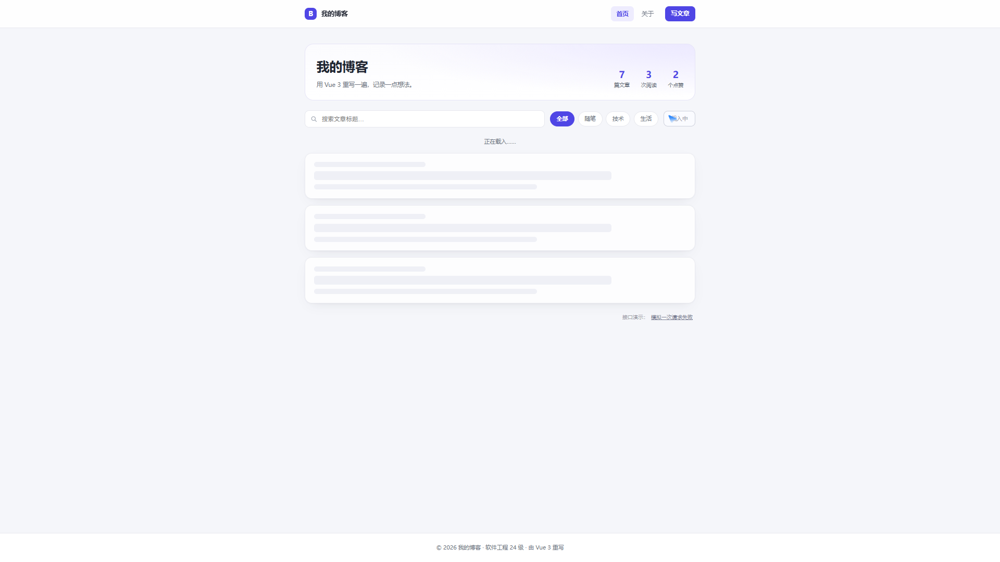
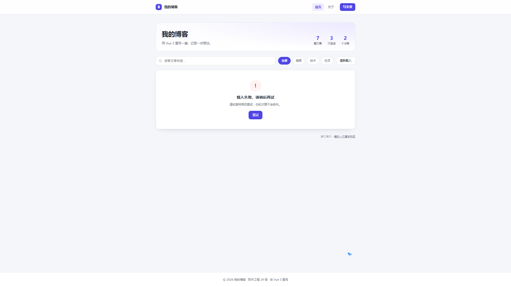
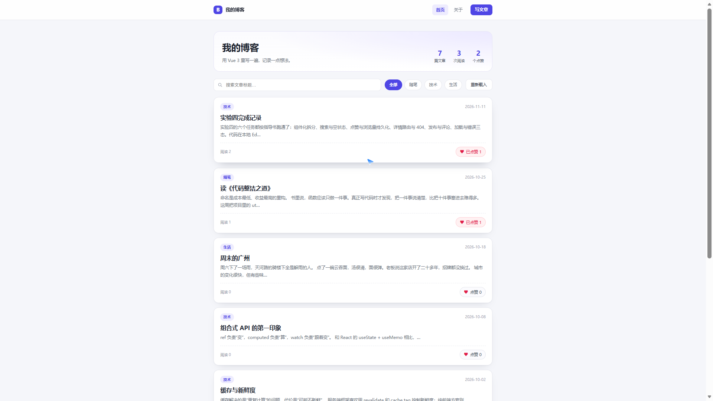

自检结果：点"重新载入"能在 0.5 秒内看到骨架屏；点"模拟一次请求失败"约 1 秒后显示错误卡片；点"重试"恢复列表，之前发布的文章仍在。

### 界面美化与最终成品

按实验二、实验三的卡片风格统一了全站：浅灰背景、白色圆角卡片、indigo 主色（`#4f46e5`）、胶囊分类按钮、hover 阴影、表单 focus 环。最终成品五个页面：

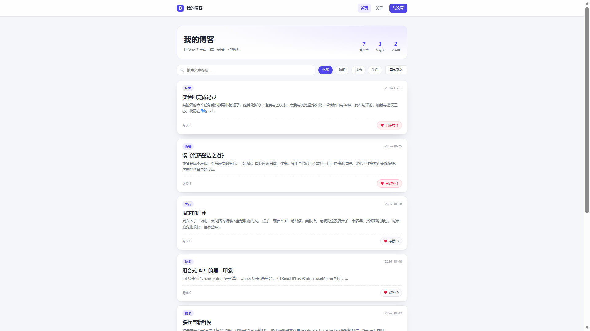
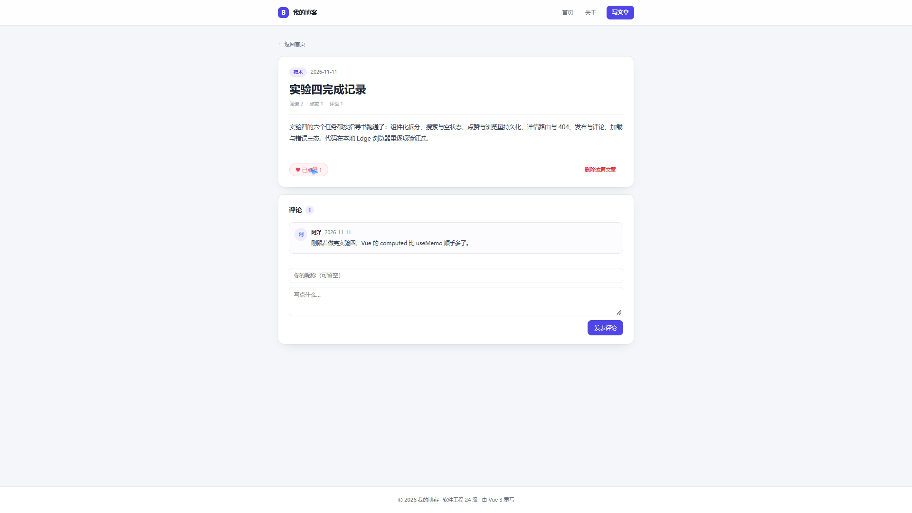
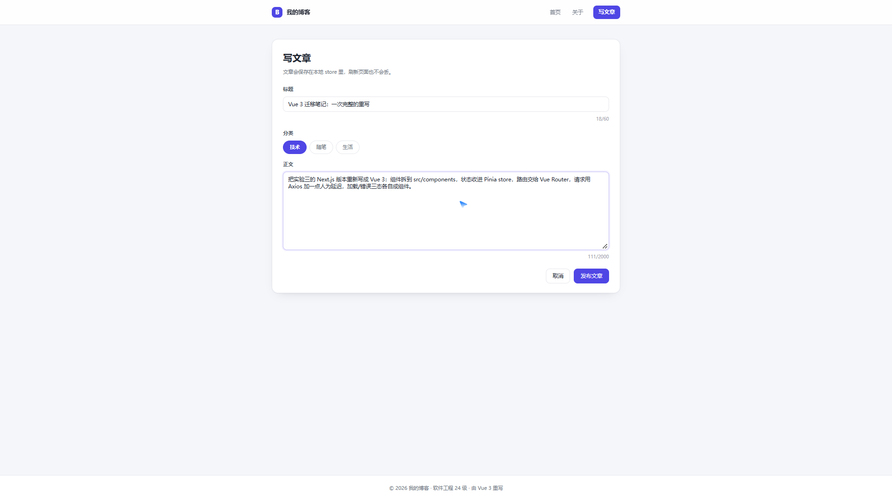


关于页展示站点信息与技术栈；页脚通过 `inject` 读取 `App.vue` 里 `provide` 的 `siteInfo`，是跨层级通信的实际用例：

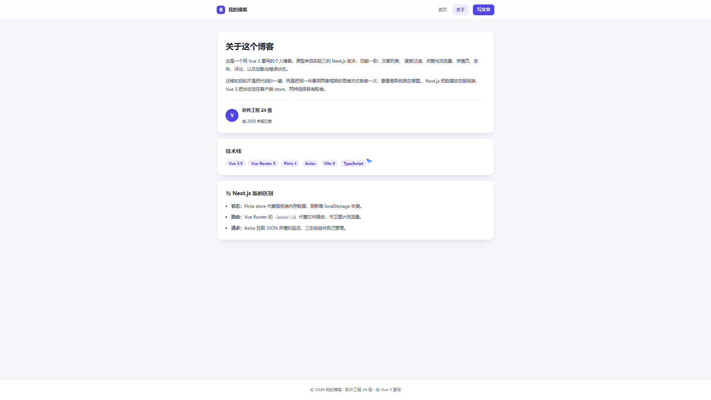

## 五、实验验证（构建与提交）

- `pnpm type-check`：`vue-tsc --build` 无输出，退出码 0；
- `pnpm lint`：`Found 0 warnings and 0 errors.`，eslint 无输出；
- `pnpm build`：`✓ 124 modules transformed`，`✓ built in 473ms`，四个页面各自成 chunk（`AboutView` 1.81 kB、`PostNewView` 1.92 kB、`PostDetailView` 3.63 kB、`NotFoundView` 0.60 kB），说明路由懒加载生效；
- `pnpm preview`：构建产物在 4173 端口可正常访问，功能与开发环境一致；
- Git 提交信息成体系（`feat:` / `docs:` 类型 + 说明），本地已提交四次（`feat` 1 次 + `docs` 3 次），待推送 Gitee 公开仓库。

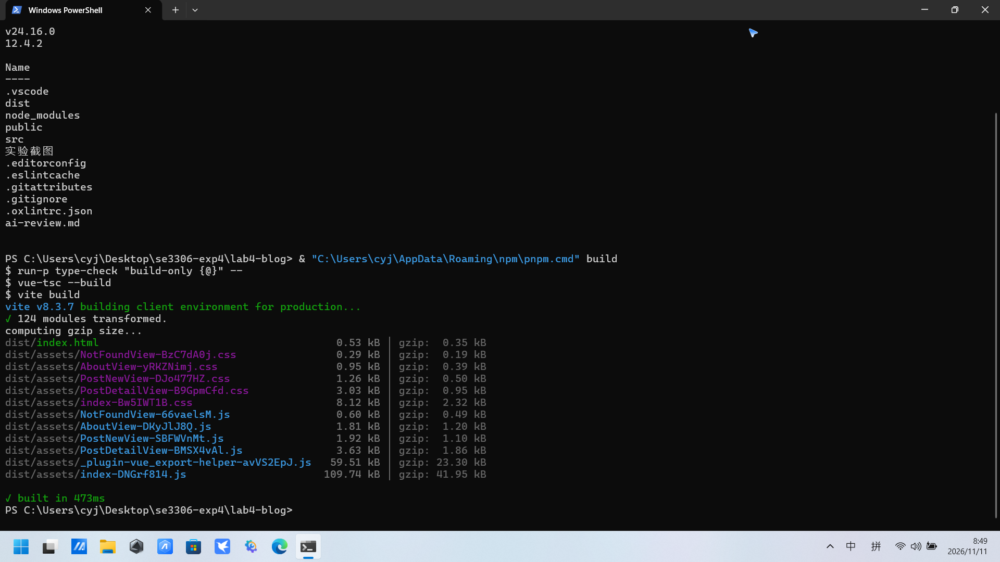
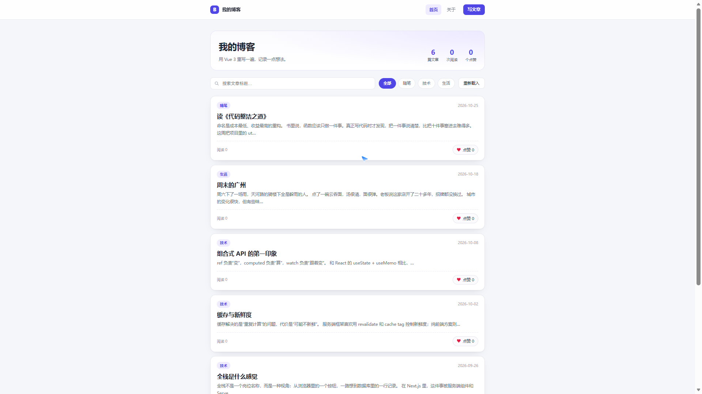

## 六、必答问题

### （1）computed 与普通函数的区别是什么？为什么搜索要用 computed？

普通函数每次被调用都会重新执行，`computed` 会把结果缓存起来，只有依赖（`keyword`、`activeCategory`、`blog.sortedPosts`）变化时才重算。同时 `computed` 本身是响应式的：模板读它时会被追踪，数据一变视图自动更新。如果写成 `filterPosts()` 方法，模板每次重新渲染都会重新遍历一遍数组，而且依赖关系要靠人保证；用 `computed` 则是"声明式"的，依赖自动收集、结果自动复用。

### （2）点赞一次，哪几处界面跟着变？为什么能一起变？

变的位置：卡片数字、按钮状态、首页 hero 的点赞总数，若在详情页则详情的数字与按钮也变。能一起变的原因是**单一数据源**：点赞数只存在于 Pinia 的 `likes`，卡片、统计、详情都是从这个对象读值，任何一处写数据，所有读它的地方同时失效重渲染。如果每个组件自己存一份计数，就会出现"卡片变了、统计没变"的不一致。

### （3）浏览量为什么放在路由守卫，而不是详情组件里？

写在详情组件里时，只有组件挂载才会执行；直接刷新详情页、或从其他页面跳入时若组件尚未挂载（或文章还没加载出来），就会漏计甚至取不到文章。放到 `router.beforeEach`，导航一发生就累加，刷新、直达、跳转三种入口都能覆盖，且职责更清楚：浏览量属于"访问行为"，不属于"页面渲染"。

### （4）持久化为什么只存业务字段？刷新后为什么不会卡在 loading？

`status`、`errorText`、`loadingText` 是运行时状态，刷新时应该重新从 `idle` 开始，如果也存进 `localStorage`，刷新后可能直接以 `error` 或 `loading` 状态启动、卡住不动。`pick` 只保留 `posts / likes / views / liked / comments / loaded`，既保证数据不丢，又保证每次启动状态干净。

### （5）三态是怎么组织的？失败后重试为什么能恢复？

状态由 store 的 `status` 统一管理，页面用 `v-if` 按 `status` 渲染三个组件：`LoadingState`（骨架屏）、`ErrorState`（提示 + 重试）、正常列表。失败恢复的关键有两点：失败开关 `failOnce` 只影响下一次请求，请求发出即复位；`reload()` 是幂等的，重试就是再调用一次，成功后 `status` 回到 `ready`。

### （6）组件通信的三种方式，在本项目里分别用在哪？

| 方式 | 位置 | 用途 |
|---|---|---|
| `props` + `emits` | `PostItem` → `HomeView` | 传文章数据、上抛点赞事件 |
| `provide` / `inject` | `App.vue` → `AppFooter` | 跨层级传站点信息，避免逐层透传 |
| 插槽 | `EmptyState` | 不同场景显示不同提示文案 |

## 七、必答思考题

### （1）Vue 的响应式和 React 的 useState 差在哪？为什么会"丢响应性"？

Vue 用 Proxy 劫持对象读写，读的时候自动记录依赖、写的时候自动通知更新，状态和视图是"自动绑定"的。React 的 `useState` 是不可变值，每次更新都要返回新对象触发重渲染，派生值靠 `useMemo` 手动声明依赖数组。丢响应性的典型场景是**解构**：`const { post } = props` 取出的是当时的值，后续 `props.post` 变化不会再反映到 `post` 上；本实验一开始就这样写过，点赞后数字不刷新，改成直接用 `props.post` 才恢复。

### （2）Vue Router 的守卫和 Next 的 middleware 有什么区别？

Vue Router 的 `beforeEach` 是**客户端**导航钩子，只在路由切换时执行，能访问 store、能改状态，但不能拦截未进入应用的请求；Next 的 `middleware` 跑在**服务端**，能在请求到达页面前做重定向、鉴权、改写，但拿不到浏览器端的 store。前者适合"页面内的跨页逻辑"（本实验的浏览量累加），后者适合"请求级的访问控制"（登录拦截、A/B 分流）。

### （3）为什么 Vue 版把数据放客户端 store，Next 版放服务端？各自代价是什么？

Vue 版是纯前端应用（Vite 构建静态产物），没有常驻服务端，数据只能放浏览器，用 `localStorage` 换来"刷新不丢、离线可用"；代价是多端不同步、数据可被用户篡改。Next 版有服务端，数据放服务端换来"多端一致、可鉴权"，代价是需要请求往返、离线不可用，且写操作要走 Server Action。这也是两套框架最本质的取舍：**数据可信度 vs 响应速度**。

### （4）如果换成真实后端（REST + 数据库），要改哪些文件？

只改 `src/api/posts.ts` 一个文件：把读 `posts.json` 换成真实接口，把 `sleep` 与失败开关去掉；再在 `stores/blog.ts` 的 `reload()` 里把"远端 + 本地合并"改成直接采用服务端数据，写操作（发文章、评论）改成调用 POST 接口。页面层、组件层、路由层一行不用动——因为它们只依赖 store 暴露的 action 与 getter，这正是把数据访问收敛在 api 层与 store 层的收益。

### （5）为什么评论、文章的 id 用"当前最大值 +1"，而不是随机数？

本地 demo 没有后端自增主键，用最大值 +1 能保证 id 单调、稳定、可预测，`v-for` 的 `:key` 不会重复；随机数可能碰撞，导致列表渲染错位或评论串到别的文章。换成真实后端后，id 应由数据库生成，前端不再参与。

## 八、提交前自查清单

| 序号 | 自查项 | 结果 |
|---|---|---|
| 1 | 项目能跑，页面正常渲染 | ✅（1.1_env、1.1_home） |
| 2 | 文章列表用 `v-for` + 组件复用 | ✅（1.1_home） |
| 3 | 点赞数字加一，按钮状态切换 | ✅（1.2_liked） |
| 4 | 刷新后点赞、浏览、评论都不丢 | ✅（3.1_persist、5.4_comment_persist） |
| 5 | 搜索即时过滤，空结果有空状态 | ✅（2.1_search、2.2_empty） |
| 6 | 详情页 `/posts/:id` 正常，刷新不丢 | ✅（4.1_detail） |
| 7 | 乱输地址进 404 | ✅（4.2_404） |
| 8 | 空标题不能发布，发布后立即出现 | ✅（5.1_new_error、5.2_new_post） |
| 9 | 评论即时显示、刷新仍在 | ✅（5.3_comment、5.4_comment_persist） |
| 10 | 加载中 / 失败 / 重试三态齐全 | ✅（6.1、6.2、6.3） |
| 11 | 类型检查与 lint 通过 | ✅（type-check 0、lint 0 warning 0 error） |
| 12 | 生产构建通过、可预览 | ✅（7.4_build、7.4_preview） |
| 13 | 六步功能可整体演示 | ✅（final_home ~ final_404） |
| 14 | 报告、README、AI 声明、代码自查齐全 | ✅（仓库根目录四个文件） |

## 九、实验体会

迁移中最容易错的一处是"响应式丢失"：一开始在 `PostItem` 里解构 `props`，点赞后数字不刷新，排查后确认解构会切断响应性，改成直接读 `props.post` 才恢复。这说明 Vue 的响应式不是"魔法"，它依赖属性访问，绕过访问就绕过了追踪。

第二处是守卫的位置：把浏览量写在详情组件里，刷新时组件尚未挂载、文章还没取到，计数会漏；移到 `router.beforeEach` 后三种入口都一致。这类问题的共同点是"把跨页面的职责塞进了单个组件"。

两套框架的取舍：Next.js 把数据和服务放一起，适合多人协作、需要统一口径的站点；Vue 3 把状态放客户端，启动快、可离线，适合个人博客这类读多写少的小应用。真正值得带走的是：同一个需求在两套框架里都有对应解法，理解对应关系，换框架就不是重新学一遍。

## 十、附录：提交物清单

| 提交物 | 位置 |
|---|---|
| 源码（任务一至六） | `lab4-blog/`（git 提交记录成体系：`feat` 1 次 + `docs` 3 次，共 4 次） |
| README（怎么跑） | `lab4-blog/README.md` |
| 实验截图 | `lab4-blog/实验截图/`（23 张） |
| 实验报告 | `lab4-blog/实验报告.md` |
| AI 使用声明 | `lab4-blog/AI使用声明.md` |
| 代码自查 | `lab4-blog/ai-review.md` |
| Gitee 公开仓库 | 本地已提交，待推送（需仓库地址与授权） |
| 部署（尤佳，未做） | 仅 `pnpm preview` 本地生产预览验证 |
